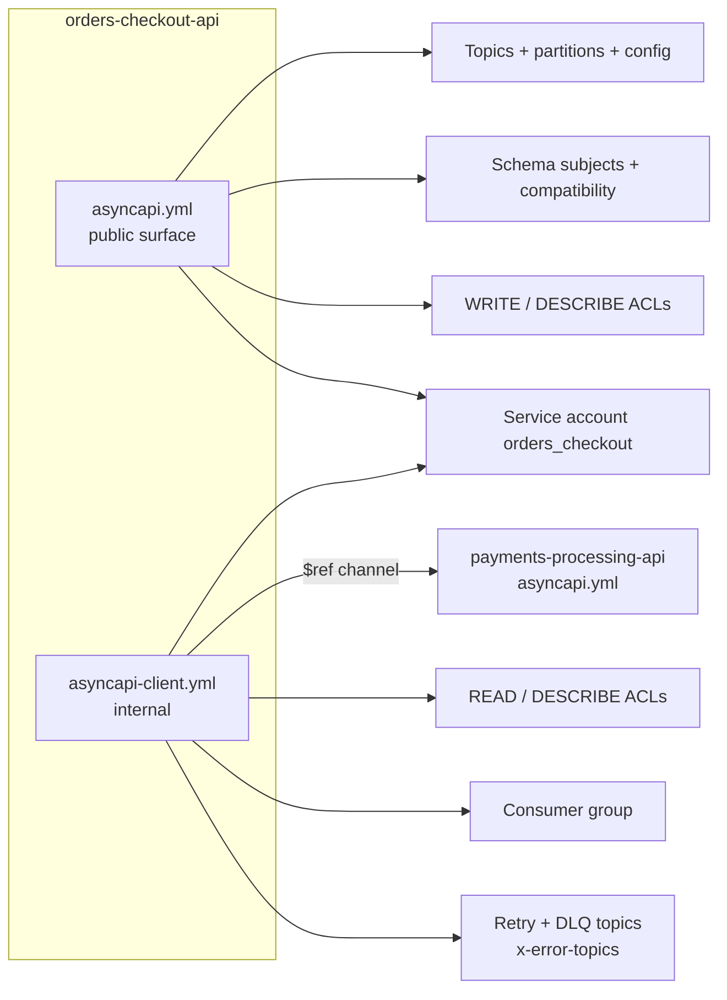
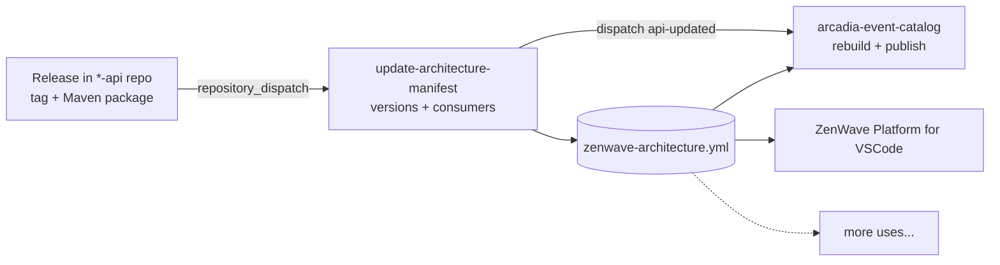

> **TODO(draft):** cover image `public/assets/articles/arcadia-editions/015-arcadia-editions-asyncapi-governance-case-study.png`. Use the same style as the 013 and 014 covers.

This article is an overview of Arcadia Editions and of the governance process we built around its AsyncAPI files. It is also the companion of the [Arcadia Editions case study on asyncapi.com](https://www.asyncapi.com/casestudies/arcadia-editions). The case study answers the usual questions about versions, tools and schemas. Here I explain the reasons behind those answers, and each section links to the article or the talk that covers it in depth.

## Why Arcadia exists

I have seen many API governance initiatives in event-driven architectures. Most of them are based on policies: naming rules, a wiki page, a review board, a checklist in the pull request template. They work well the first year, because somebody cares and somebody is checking. Then the people change, the checklist becomes a formality, and the contracts and the Kafka cluster slowly start to describe different systems.

I believe the answer is not more policies or stricter enforcement. The answer is automation: if topics, schemas, permissions, application code... are all derived from the AsyncAPI files, keeping them aligned is a side effect of the normal work of the teams. Nobody has to remember a rule. That is what I call a governance process built to last.

Arcadia Editions is the company I built to show this working end to end. It is fictional, but everything is real code and real pipelines, and it is all public in the [arcadia-editions GitHub organization](https://github.com/arcadia-editions). You can clone it, check every claim in this article against the repositories, and reuse whatever is useful for you.

If you read through, you will find:

- the governance problems Arcadia was designed to reproduce, and the principle that answers each one
- how both faces of API drift, application and platform, are detected before they reach a running system
- why every service has two AsyncAPI files, and why that second file is what tells you who the consumers are
- the architecture manifest, and what you can build on top of it once it stays accurate on its own
- how to run the provisioning on your laptop and how to configure code generation in your own services

## Meet Arcadia Editions

In the story, Arcadia Editions is a specialty retailer of limited-edition board games. They sell in drops: a fixed number of copies goes on sale at a given time, and when they are gone, they are gone. This makes inventory the scarce resource, so the checkout flow reserves stock before taking the payment, and every failure path ends in a compensation. The payment authorization is voided, the stock goes back to the pool and the order is cancelled.

We discovered this flow with Event Storming and modeled it as the [Place Order flow](https://github.com/arcadia-editions/arcadia-editions-architecture/blob/main/business-flows/place-order-flow.zfl) in ZFL, a small language for business flows. If you want the long version, it starts in [Meet Arcadia Editions](/articles/arcadia/001-meet-arcadia-editions) and continues in [Finding Arcadia Editions' Architecture](/articles/arcadia/005-finding-bounded-contexts).

The Place Order flow crosses five bounded contexts, owned by different teams: Orders Checkout, Catalog Inventory, Payments Processing, Fulfillment Shipping and Notifications. They talk through domain events on Kafka, with Confluent Cloud as broker and Schema Registry.

The GitHub organization is organized the same way a real company would organize it:

| Repository | What it holds |
| --- | --- |
| `{domain}-{service}-api`, one per service | `asyncapi.yml`, `asyncapi-client.yml`, the Avro schemas, `openapi.yml` and the ZDL domain model |
| [api-contract-commons](https://github.com/arcadia-editions/api-contract-commons) | Shared AsyncAPI sections: servers, common headers, message traits, retry and dead letter tiers |
| [api-product-workflows](https://github.com/arcadia-editions/api-product-workflows) | The reusable GitHub Actions workflows for CI, releases and Kafka provisioning |
| [arcadia-editions-architecture](https://github.com/arcadia-editions/arcadia-editions-architecture) | The business flows and `zenwave-architecture.yml`, the architecture manifest |
| [arcadia-event-catalog](https://github.com/arcadia-editions/arcadia-event-catalog) | The generated EventCatalog site |
| [orders-checkout-service-java](https://github.com/arcadia-editions/orders-checkout-service-java), [payments-processing-service-java](https://github.com/arcadia-editions/payments-processing-service-java) | The first two Spring Boot microservices, with their SDK generated from both contracts |

There is also a Spring Modulith implementation of the whole domain, in [Java](https://github.com/arcadia-editions/arcadia-editions-modulith-service-java) and [Kotlin](https://github.com/arcadia-editions/arcadia-editions-modulith-service-kotlin). Its events are internal to the modulith, so it does not use Kafka or AsyncAPI, and it is not part of this case study.

## The contract drifts from the broker

This is the first problem Arcadia reproduces. The AsyncAPI file says the retention of a topic is seven days, but somebody changed it to one day in the Confluent console last month. Or the retention was never in the AsyncAPI file, and it lives in a Terraform file in another repository that nobody reviews against the API. After a few of these, people stop reading the API and they start asking someone.

### The broker is part of the API

In REST you can mostly ignore the gateway when you design a client. In an event-driven architecture you can't ignore the broker, because its settings shape how producers and consumers are designed:

- partitions decide how many consumers can run in parallel, and the ordering you get
- retention decides how far back a consumer can replay. A consumer for one week of retention is not designed the same way as one for one year
- schema compatibility decides the order of the rollouts. With `FORWARD` compatibility the producer can be deployed first, with `BACKWARD` the consumers must be deployed first

So these settings belong in the contract, next to the operations and the schemas. [AsyncAPI Governance Built to Last](/articles/arcadia/014-async-api-governance-built-to-last) explains this argument in more detail.

### API drift has two faces

API drift is the progressive divergence between the declared contract and the system that implements and operates it. In event-driven architectures it has two faces, as I explained in [API Drift in Event-Driven Architectures has Two Faces](https://www.asyncapi.com/blog/api-drift-in-event-driven-architectures-has-two-faces):


- **Application drift**: the code of producers and consumers does something different from what the contract says. A field with another name, a header that nobody sends, a listener on the wrong topic...
- **Platform drift**: the topics, schemas and permissions in the broker are different from what the contract says.

This is the first principle of Arcadia: **API and platform stay in sync automatically, without much policy or enforcement**. We get there by deriving both sides from the same AsyncAPI file, so each kind of drift has a detector that runs on every change:

| | Derived from AsyncAPI | Drift detector | Tool |
| --- | --- | --- | --- |
| Application drift | A complete, non-editable Java SDK: models, headers, typed producers and typed listeners | The compiler | [ZenWave AsyncAPI Generator](https://www.zenwave360.io/zenwave-sdk/plugins/asyncapi-generator/) |
| Platform drift | Terraform for Kafka topics, Schema Registry subjects and ACLs | `terraform plan` | [ZenWave AsyncAPI Ops](https://www.zenwave360.io/zenwave-sdk/plugins/asyncapi-ops/) |

On the application side, the SDK is generated in `target` on every build, so nobody can edit it. When a contract changes, the generated code changes with it, and the build fails in the handwritten code that still assumes the old contract. The compiler is the drift detector, and it is a very strict one. I gave a talk about this side: [Stop API Drift: Generate Java from AsyncAPI](https://youtu.be/AwZoXxyQj9o).

On the platform side, every pull request that touches a contract runs `terraform plan`, so the reviewers see exactly which topics, schemas and ACLs change in the cluster before anything is applied. This also works in the other direction. If someone changes the retention by hand in the console, the next plan shows the same diff in reverse, and the apply puts back what the contract says. The details are in [Provisioning Infrastructure with Terraform from AsyncAPI](/articles/arcadia/013-infrastructure-provisioning-asyncapi-terraform) and in the talk [Stop API Drift: Provision Kafka from AsyncAPI](https://youtu.be/S8Sknrdl1jM).

<div class="youtube-embed">
<iframe src="https://www.youtube.com/embed/S8Sknrdl1jM" title="Stop API Drift: Provision Kafka from AsyncAPI" frameborder="0" allow="accelerometer; autoplay; clipboard-write; encrypted-media; gyroscope; picture-in-picture; web-share" allowfullscreen></iframe>
</div>

## The same information is written twice

The second problem is duplication. When the AsyncAPI file describes the topics and a Terraform module describes them again, you have two sources of truth, and everybody hopes they stay in sync forever. They don't.

The second principle of Arcadia is the answer: **the APIs are the source of truth, and everything else is derived from them**. Application code, Kafka topics, schemas, permissions, documentation... all of it is generated from the AsyncAPI and Avro files, and nobody edits a derived artifact by hand.

### The platform settings live in the contract

For this to work, the contract has to carry everything the platform needs. AsyncAPI Kafka bindings cover most of it, and Arcadia adds a few extensions for the rest. This is a channel of `orders-checkout-api`, with production values and overrides for the develop environment:

```yaml
channels:
  order-created-event-v1:
    address: orders-checkout.order-created.event.avro.v1
    messages:
      OrderCreatedEvent:
        $ref: "#/components/messages/OrderCreatedEvent"
    bindings:
      kafka:
        partitions: 3
        replicas: 3
        topicConfiguration:
          cleanup.policy: [ "delete" ]
          retention.ms: 604800000
        x-env-server-overrides:
          develop:
            partitions: 1
            replicas: 1
```

The schema compatibility is declared in a message trait, and provisioning applies it to the subject in Schema Registry:

```yaml
KafkaSchemaCompatibility:
  bindings:
    kafka:
      bindingVersion: '0.5.0'
      schemaIdLocation: 'payload'
      schemaLookupStrategy: 'TopicNameStrategy'
      x-schemaCompatibility: 'FORWARD'
```

Things that are the same for every service are not copied either. Servers, common headers and the retry and dead letter tiers live in [api-contract-commons](https://github.com/arcadia-editions/api-contract-commons), and every contract points to them with a remote `$ref`.

### Treat your APIs as products

Each service has its own `*-api` repository, separate from the code of the service, with its own release lifecycle. The pipelines are thin GitHub Actions callers that delegate to the shared [api-product-workflows](https://github.com/arcadia-editions/api-product-workflows):

- **CI** validates and lints every changed contract on each pull request. Today the linting uses Spectral, and it is moving to OpenLint.
- **Releases** tag the contracts and publish them as Maven packages. `asyncapi.yml`, `asyncapi-client.yml` and the Avro schemas are released together as one bundle, so consumers depend on a released contract and not on a copy.
- **Provisioning** generates the Terraform from the AsyncAPI files. Merging to `develop` provisions the development cluster, and each release packs that Terraform so the same files are promoted to pre and prod.

The major version is part of the channel name and of the topic address, as in `orders-checkout.order-created.event.avro.v1`. I wrote about this way of working in [Treat Your Domain Models and APIs as Products](/articles/arcadia/010-treat-your-service-apis-as-products).

## Nobody knows who the consumers are

The third problem is the one I find in every company with more than a handful of services. Reading one API is easy. Finding out who reads from a given topic means reading every API in every repository, and in practice nobody does it. So before changing `OrderConfirmed`, you ask in a chat channel and you hope the right people answer.

### Public contract and client contract

AsyncAPI v3 is [application-centric](https://www.asyncapi.com/docs/reference/specification/v3.0.0#introduction). Each file describes what this application does, its `send` and `receive` operations, and not what others can do with it. That does not prevent using more than one file to describe different aspects of the same service, and in Arcadia every service has two:

- `asyncapi.yml` is the **public surface**: the topics the service owns and the messages it publishes. This is what other teams read.
- `asyncapi-client.yml` is **internal**: the channels the service consumes, written as `$ref`s to the public contracts of their producers. It is not published to consumers, but it is documented, versioned and released, because provisioning needs it.

This is the client contract of Orders Checkout consuming an event from Payments, with its retry and dead letter topics:

```yaml
# orders-checkout-api/asyncapi-client.yml (excerpt)
channels:
  payment-authorized-event-v1:
    $ref: https://raw.githubusercontent.com/arcadia-editions/payments-processing-api/main/asyncapi.yml#/channels/payment-authorized-event-v1

operations:
  onPaymentAuthorizedEvent:
    action: receive
    channel:
      $ref: "#/channels/payment-authorized-event-v1"
    bindings:
      kafka:
        x-error-topics:
          addressTemplate: "${groupId}.__.${channel.address}.${suffix}"
          retryTopics: 3
          retrySuffixes: [retry-5s, retry-30s, retry-5m]
          retry:
            $ref: https://raw.githubusercontent.com/arcadia-editions/api-contract-commons/refs/heads/main/asyncapi-error-topics.yml#/components/error-topics/retry/silver
          dlq:
            $ref: https://raw.githubusercontent.com/arcadia-editions/api-contract-commons/refs/heads/main/asyncapi-error-topics.yml#/components/error-topics/dlq/compliance
```

The two files provision different things. From the public contract we create the topics, register the schemas and give write permissions. From the client contract we create nothing on the producer's side, we only give read permissions, plus the retry and dead letter topics of that consumer:

| Resource | From `asyncapi.yml` (owned) | From `asyncapi-client.yml` (consumed) |
| --- | --- | --- |
| Kafka topic, with partitions and config | Created | Not created |
| Schema subject and compatibility level | Registered and set | Not touched |
| Topic ACLs | `WRITE` and `DESCRIBE` per `send` operation | `READ` and `DESCRIBE` per `receive` operation |
| Schema Registry access | `DeveloperRead` per subject | `DeveloperRead` per subject |
| Retry and dead letter topics | | Created from `x-error-topics` |

For `orders-checkout-api` the first plan adds 31 resources: 1 service account, 4 topics, 4 schemas, 4 subject configs, 12 topic ACLs and 6 role bindings.

> **TODO(diagram):** public vs client contract, and what each one provisions. Render it in the same style as the 013 image.

<!--

-->

And this is the important rule: **if you don't declare that you consume a topic, you don't get permission to read it**. Without permission, you don't consume.

It may sound strict, but it is what keeps the process honest. Nobody can start reading a topic in secret, because the only way to get read access is to add the channel to your client contract, and that goes through the same pull request, the same review and the same pipeline as everything else. As a consequence, the list of consumers of every topic is always written down, in the client contracts.

### The architecture manifest

That solves who the consumers are, but the answer is still spread across dozens of `asyncapi-client.yml` files in dozens of repositories. With two services you can open them by hand. With a hundred you can't.

This is the third principle of Arcadia: **one architecture manifest gathers what is spread across repositories, without repeating it**. The manifest, [`zenwave-architecture.yml`](https://github.com/arcadia-editions/arcadia-editions-architecture/blob/main/zenwave-architecture.yml), is the index of every domain, service and contract, with pointers to the files and the released versions:

```yaml
"orders-checkout":
  id: "orders.checkout.orders-checkout"
  repository: "orders-checkout-api"
  version: "0.1.0"
  artifacts:
    - type: asyncapi
      path: "asyncapi.yml"
      version: "0.1.0"
      releaseGroup: asyncapi-all
    - type: asyncapi-client
      path: "asyncapi-client.yml"
      version: "0.1.0"
      releaseGroup: asyncapi-all
  consumers:
    - "payments.payment-processing.payments-processing#asyncapi-client"
    - "fulfillment.shipping.fulfillment-shipping#asyncapi-client"
    - "notifications.customer-communications.notifications-consumer#asyncapi-client"
```

The teams don't maintain it by hand. Every API release sends a `repository_dispatch` to the architecture repository, and the `update-architecture-manifest` workflow updates the released versions and the consumers of each contract, merges the change and triggers the rebuild of the EventCatalog. The manifest is explained in [The Master YAML: A Manifest of Your Entire Architecture](/articles/arcadia/011-master-yaml-architecture-manifest).

> **TODO(diagram):** the release loop. Start from the existing `012-release-to-catalog-pipeline.svg` and add ZenWave Platform reading the manifest.

<!--

-->

A central YAML file is not very interesting by itself. What makes it useful is that it stays accurate without anyone looking after it, and then you can build tools on top of it that answer the questions you can't answer by browsing repositories.

### First use: EventCatalog

The first tool we built on top of the manifest is the ZenWave EventCatalog generator. It reads the manifest, follows the pointers to every AsyncAPI file, and builds the [Arcadia Event Catalog](https://arcadia-editions.github.io/arcadia-event-catalog/), a public website with every domain, service and event, and the producers and consumers of each one. Each `*-api` repository also has a `SUMMARY.md`, an `EVENT_CATALOG.md` and a `CHANGELOG.md` that the catalog picks up.

The website is for the people who will never open a YAML file, business and technical. It is rebuilt after every API release, so it is never older than the last release. More about it in [Arcadia Architecture Manifest meets Event Catalog](/articles/arcadia/012-arcadia-architecture-manifest-meets-event-catalog).


### Second use: ZenWave Platform for VSCode

The EventCatalog is good for browsing. But when you are working on a contract, you want the same information in your editor, next to the files you are changing.

[ZenWave Platform for VSCode](https://www.zenwave360.io/zenwave-platform/) is an open source extension that loads the architecture manifest into VSCode. It shows the domains, services and contracts of the whole architecture as a tree, and from there you can navigate between them and open every artifact, either from your local workspace or straight from GitHub.

> **TODO(screenshot):** the Arcadia manifest loaded in the ZenWave Platform tree view: domains, then services, then their contracts (`asyncapi.yml`, `asyncapi-client.yml`, `openapi.yml`, `domain-model.zdl`).

The question from the beginning of this section, who consumes `OrderConfirmed`, becomes a click. You select the channel and you see its producer and every consumer, and you can jump to the client contract of each one.

> **TODO(screenshot):** `order-confirmed-event-v1` selected, with the Orders Checkout producer and the Payments, Fulfillment and Notifications consumers, and navigation to one of their `asyncapi-client.yml` files.

Because the manifest knows where every file lives, you can also open a contract or an Avro schema of another team without cloning their repository.

> **TODO(screenshot):** an AsyncAPI contract or an Avro schema of another service opened from the manifest, rendered with AsyncAPI Preview.

> **TODO(screenshot):** optional short GIF of the navigation: tree view, then a channel, then a consumer, then its client contract.

ZenWave Platform is being built right now, so expect it to change while you read this. I am building it because I wanted the manifest to be useful during the daily work and not only as a website.

> **TODO(review):** describe the ZenWave Platform features exactly as they are when the screenshots are taken.

### More uses will come

Once the manifest is accurate, every question about the architecture as a whole becomes a query on one file: impact analysis before a breaking change, unused topics, services without consumers, a context for AI agents working across repositories... I expect more tools to appear on top of it, from us or from anybody else, because the manifest format and its JSON schema are public.

## Authoring contracts without writing YAML

Everything above works with AsyncAPI and Avro files written by hand, and many teams will prefer that. Teams can also write their domain model in ZDL, a small language for domain models, and generate the AsyncAPI and Avro files from it. Either way, the governed artifact is the AsyncAPI file: the pipelines, the provisioning and the manifest only look at the AsyncAPI and Avro files, so how they were written doesn't matter.

For editing, we use VSCode with [AsyncAPI Preview](https://marketplace.visualstudio.com/items?itemName=asyncapi.asyncapi-preview) to render and validate the contracts, and ZenWave Platform to navigate them. The ZDL side is explained in [DSL Modeling for APIs: Generate OpenAPI and AsyncAPI from ZDL](/articles/arcadia/009-dsl-modeling-for-apis-generate-openapi-and-asyncapi-from-zdl).

## Try it yourself

Everything is public, so you can follow this case study with your own hands. Start by cloning the [arcadia-editions organization](https://github.com/arcadia-editions) and opening [orders-checkout-api](https://github.com/arcadia-editions/orders-checkout-api), which is the example used across the series.

### Run the provisioning on your laptop

The guide [Run Kafka provisioning on your laptop](https://github.com/arcadia-editions/api-product-workflows/blob/main/docs/run-kafka-provisioning-locally.md) runs the same scripts as the GitHub pipelines, from the `orders-checkout-api` contracts to a real Confluent Cloud cluster. You need:

- JBang, to run the ZenWave generator as `jbang zw`
- Terraform 1.2 or newer, and an HCP Terraform account for the state
- the Confluent CLI, and a Confluent Cloud account with one environment, one Kafka cluster and Schema Registry

The guide shows how to read the contract as topics, schemas and ACLs, then it generates and plans the Terraform. It also changes the contract to show how the plan reacts to a config change, to a new consumer and to drift from the console.

### Browse the catalog

The [Arcadia Event Catalog](https://arcadia-editions.github.io/arcadia-event-catalog/) is live, generated from the manifest. It is a good place to see the whole Place Order flow before reading any YAML.

### Generate the SDK in your services

The first two microservices are public: [orders-checkout-service-java](https://github.com/arcadia-editions/orders-checkout-service-java) and [payments-processing-service-java](https://github.com/arcadia-editions/payments-processing-service-java). Each one generates its SDK during the build with the [ZenWave SDK Maven plugin](https://www.zenwave360.io/zenwave-sdk/plugins/asyncapi-generator/). The SDK is complete: Avro models, headers, typed producers, typed listener interfaces and the Spring implementation that connects them to Kafka. It is generated into `target`, so every build deletes it and writes it again.

The important rule here is that **the build reads the contract from its canonical location, never from a local copy**. A copy of `asyncapi.yml` in `src/main/resources` is the beginning of application drift. The canonical location can be:

- the released Maven package of the `*-api` repository, read from the classpath
- an HTTP URL, like a GitHub raw URL, Apicurio, Artifactory... with credentials if needed

The Arcadia services use GitHub raw URLs. The repositories are public, so they don't need credentials, but the `authentication` settings stay in the configuration, commented out, as a reference for private repositories or for Apicurio.

The plugin reads one file per execution, so each service has two executions: `generate-asyncapi` for `asyncapi.yml` and `generate-asyncapi-client` for `asyncapi-client.yml`. This is the configuration of `orders-checkout-service-java`, with the URLs shortened:

```xml
<properties>
    <basePackage>com.arcadiaeditions.orders.checkout</basePackage>
    <asyncapi.inputSpec>https://raw.githubusercontent.com/arcadia-editions/orders-checkout-api/refs/heads/main/asyncapi.yml</asyncapi.inputSpec>
    <asyncapi.avro.imports>.../orders-checkout-api/.../avro/StockUnavailableItem.avsc,.../avro/OrderConfirmedItem.avsc,...</asyncapi.avro.imports>
    <asyncApiProducerApiPackage>${basePackage}.asyncapi.provider</asyncApiProducerApiPackage>
    <asyncApiConsumerApiPackage>${basePackage}.asyncapi.provider</asyncApiConsumerApiPackage>

    <asyncapi.client.inputSpec>https://raw.githubusercontent.com/arcadia-editions/orders-checkout-api/refs/heads/main/asyncapi-client.yml</asyncapi.client.inputSpec>
    <asyncapi.client.avro.imports>.../catalog-inventory-api/.../avro/StockReleaseReason.avsc,.../avro/StockReleasedItem.avsc</asyncapi.client.avro.imports>
    <asyncApiClientApiPackage>${basePackage}.asyncapi.client</asyncApiClientApiPackage>
</properties>

<plugin>
    <groupId>io.zenwave360.sdk</groupId>
    <artifactId>zenwave-sdk-maven-plugin</artifactId>
    <version>${zenwave.version}</version>
    <configuration>
        <inputSpec>${asyncapi.inputSpec}</inputSpec>
        <skip>false</skip>
        <addCompileSourceRoot>true</addCompileSourceRoot>
        <addTestCompileSourceRoot>true</addTestCompileSourceRoot>
        <!-- <authentication> -->
        <!--     <authentication><key>API_KEY</key><value>XXX</value></authentication> -->
        <!-- </authentication> -->
    </configuration>
    <executions>
        <execution>
            <id>generate-asyncapi</id>
            <phase>generate-sources</phase>
            <goals><goal>generate</goal></goals>
            <configuration>
                <generatorName>AsyncAPIGenerator</generatorName>
                <configOptions>
                    <role>provider</role>
                    <producerApiPackage>${asyncApiProducerApiPackage}</producerApiPackage>
                    <consumerApiPackage>${asyncApiConsumerApiPackage}</consumerApiPackage>
                    <avroCompilerProperties.imports>${asyncapi.avro.imports}</avroCompilerProperties.imports>
                </configOptions>
            </configuration>
        </execution>
        <execution>
            <id>generate-asyncapi-client</id>
            <phase>generate-sources</phase>
            <goals><goal>generate</goal></goals>
            <configuration>
                <inputSpec>${asyncapi.client.inputSpec}</inputSpec>
                <generatorName>AsyncAPIGenerator</generatorName>
                <configOptions>
                    <!-- asyncapi-client.yml is written from this service's point of view (action: receive) -->
                    <role>provider</role>
                    <producerApiPackage>${asyncApiClientApiPackage}</producerApiPackage>
                    <consumerApiPackage>${asyncApiClientApiPackage}</consumerApiPackage>
                    <avroCompilerProperties.imports>${asyncapi.client.avro.imports}</avroCompilerProperties.imports>
                </configOptions>
            </configuration>
        </execution>
    </executions>
    <dependencies>
        <dependency>
            <groupId>io.zenwave360.sdk.plugins</groupId>
            <artifactId>asyncapi-generator</artifactId>
            <version>${zenwave.version}</version>
        </dependency>
    </dependencies>
</plugin>
```

The Avro imports list the types that the event schemas reference by name, with the dependencies first. A URL can't be listed like a folder, so each file is listed explicitly. The client execution imports the types of the producers, in this case from `catalog-inventory-api`.

Both executions use `role` `provider`, and this surprises people the first time. The plugin also has a `client` role, which reads the producer's `asyncapi.yml` and generates the opposite side of each operation. But `asyncapi-client.yml` is already written from the point of view of this service: its operations are `action: receive`, so generating it as provider gives exactly the listeners it declares. With `client` on the remote `asyncapi.yml` of each producer, you would need a list of `operationIds` in the pom to choose what you consume. That is a second copy of the list that is already in `asyncapi-client.yml`, and nothing would stop a service from generating a listener for a topic it never declared.

### Where the SDK lives

The generated SDK lives outside the hexagon, one package per contract:

- `<basePackage>.asyncapi.provider`, generated from `asyncapi.yml`
- `<basePackage>.asyncapi.client`, generated from `asyncapi-client.yml`

We don't split it into `commands` and `events`, because one contract can both send and receive. Payments, for example, consumes some of its own events, like `payment-failed` to retry the payment, from the same `asyncapi.yml` where it publishes them. The Avro classes follow the namespace of their schema, so the types of another team end up in that team's package. This is the generated tree of `orders-checkout-service-java`:

```text
com/arcadiaeditions/
├── orders/checkout/
│   ├── asyncapi/
│   │   ├── provider/                  # from asyncapi.yml
│   │   │   ├── OrdersCheckoutEventsProducer.java
│   │   │   └── DefaultOrdersCheckoutEventsProducer.java
│   │   └── client/                    # from asyncapi-client.yml
│   │       ├── IPaymentAuthorizedEventV1ConsumerService.java
│   │       ├── PaymentAuthorizedEventV1Consumer.java
│   │       ├── IStockReleasedEventV1ConsumerService.java
│   │       └── StockReleasedEventV1Consumer.java
│   └── events/avro/                   # OrderCreated, OrderConfirmed, OrderCancelled, StockUnavailable...
├── payments/processing/events/avro/   # PaymentAuthorized
└── catalog/inventory/events/avro/     # StockReleased, StockReleasedItem, StockReleaseReason
```

The core and the adapters of the service use the SDK, and the SDK doesn't depend on them. Because the SDK is outside the hexagon, this is a simple dependency rule that ArchUnit can check.

> **TODO(draft):** the services have the ArchUnit dependency in the pom, but the architecture test doesn't exist yet. Link it when it does.

The rest of the service, the hexagonal core and the web adapters, is generated once from the ZDL model with `zenwave-scripts.zw`, and then it is edited by hand. Its default layout places the AsyncAPI packages inside the hexagon, so `BackendApplicationDefaultPlugin` overrides `layout.asyncApiModelPackage`, `layout.asyncApiProducerApiPackage` and `layout.asyncApiConsumerApiPackage` to match the pom.

> **TODO(review):** the `zenwave-scripts.zw` overrides have not been run yet. Confirm the generated core compiles against `asyncapi.provider` before publishing.

The SDK is generated only in Java. Kotlin services use it directly, as any other Java library.

> **TODO(draft):** describe how the services connect to the provisioned development cluster.

### Tests

The first tests are the drift detectors themselves, and they run on every pull request: validation and linting of the contracts, the compiler on the generated SDK, and `terraform plan` on the platform.

> **TODO(draft):** at the service level, the plan is integration tests against Kafka and Schema Registry in Docker Compose and API tests with Karate, as in `zenwave-playground/examples/asyncapi-shopping-cart` and `order-fulfillment-kotlin`. The two services don't have these tests yet. Confirm when they do.

## Governance that keeps working

I started with the problem behind all the others: governance based on policies fades after two or three years, because it depends on people remembering and checking. Arcadia doesn't remove the rules, it moves them into the pipelines, where they run every time without anybody having to remember them.

The rule about consumers is a good example of what that means in practice. Nobody has to keep a list of who reads from which topic, and nobody has to check that the list is up to date. A team that wants to consume an event adds the channel to its client contract, because otherwise it doesn't get permission to read. From that same declaration the pipelines create:

- the read ACL and the consumer group
- the retry and dead letter topics
- the consumer entry in the manifest, and from there in the EventCatalog and in ZenWave Platform

The teams just do their normal work. In 3, 5 or 7 years the contracts and the platform will still describe the same system, and nobody had to make a special effort for it.

The case study with all the technical details is on [asyncapi.com](https://www.asyncapi.com/casestudies/arcadia-editions), and all the code is in the [arcadia-editions GitHub organization](https://github.com/arcadia-editions).
